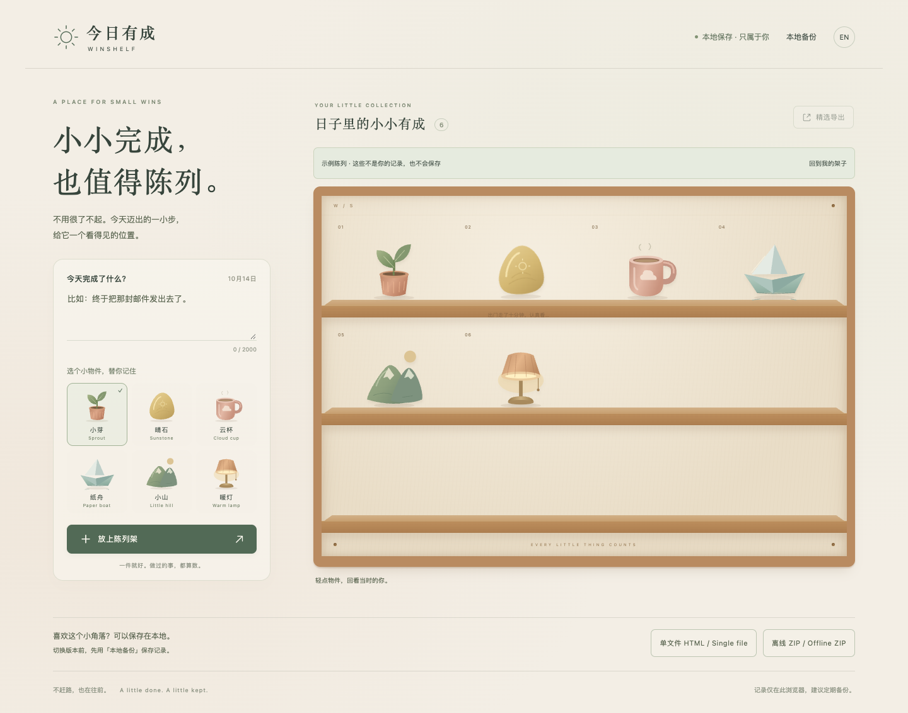
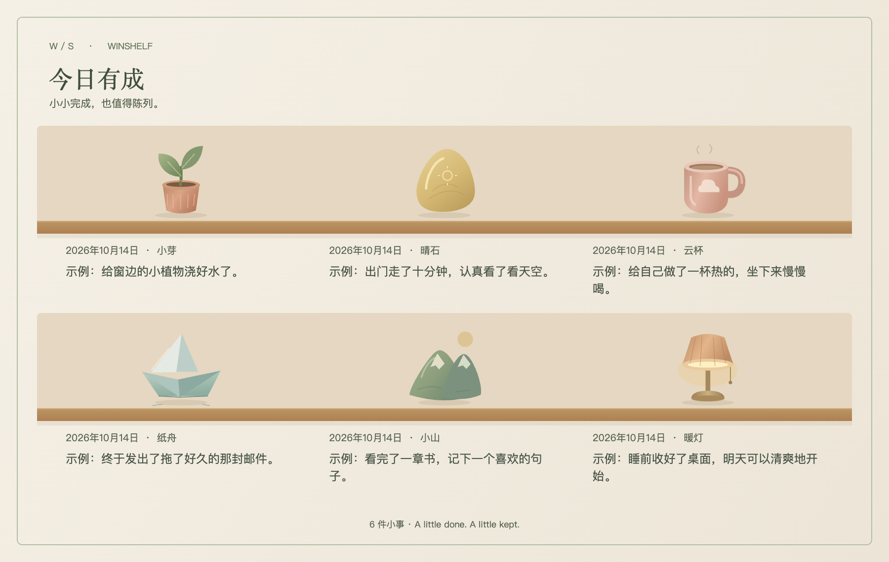

# 今日有成 / WinShelf

**小小完成，也值得陈列。** 写下今天做完的一件小事，选一个小物件，让它落在温暖的陈列架上。轻点物件，回看当时的文字和日期。

### 直接使用

**[▶ 在线试玩](https://tryu-ai.github.io/winshelf/)** · **[下载单文件 HTML](https://tryu-ai.github.io/winshelf/downloads/WinShelf.html)** · **[下载离线 ZIP](https://tryu-ai.github.io/winshelf/downloads/WinShelf-offline.zip)**

无需账号、安装或 API Key。在线页面底部提供单文件与 ZIP 下载按钮；HTML 链接也可打开后通过浏览器“另存为”保存。ZIP 解压后直接双击 `WinShelf.html`，三个源码文件不需要分别下载。断网也能记录、回看、编辑和导出。

### 20 秒开始

1. 写下一件今天做完的小事。
2. 选小芽、晴石、云杯、纸舟、小山或暖灯，点“放上陈列架”。
3. 点物件回看；可以修改文字、日期和物件。删除需确认，20 秒内可以撤销。

“先看看示例”打开的是明确标注、不保存的临时示例架。做过的事都算数，不需要连续打卡，也没有断签惩罚。

### 手机使用与导出

直接用手机浏览器打开在线试玩。页面支持窄屏与触控；添加后会把新物件带到视野中。编辑、确认删除和图片导出都在同一个页面完成。

在“精选导出”中勾选 1–9 件，选择“物件 + 完整文字与日期”或“仅物件”，生成预览后保存 PNG。只有勾选的记录进入图片，长文不会被截断。手机若打开图片而没有直接下载，可以长按预览图片保存。分享前先看一眼预览，确认文字适合公开。

### 先备份，再迁移

**记录只保存在当前浏览器。** 没有云同步。在线页面、离线文件、不同浏览器的记录相互独立；清理浏览器数据、切换设备或移动离线文件都可能让原记录无法读取。

通过“本地备份”下载全部记录的 JSON，再在另一份 WinShelf 中恢复。恢复前显示数量，确认后追加，相同记录跳过，不覆盖已有陈列。PNG 适合展示，JSON 才能恢复可编辑记录；备份包含全部文字与日期，请妥善保存。

每条最多 2000 字符，最多 500 件；每张 PNG 最多 9 件。保存失败会保留草稿并提示，损坏的本地数据不会被新记录覆盖。撤销窗口不跨刷新。

### 小而透明

- 原生 HTML / CSS / JavaScript，六个物件为本项目原创 SVG。
- 无账号、追踪、广告、支付、LLM/API 或后台数据抓取。
- 文本按纯文字处理；PNG 从已选数据绘制，不截图隐藏页面内容。
- 支持键盘 Tab、方向键和 Enter；Esc 关闭对话框。尊重减少动态效果设置。
- 中文默认，顶部 EN / 中 可切换基础英文界面。

本项目只探索“物件陈列是否使人更愿意记录和回看”，不宣称记录或分享机制首创，也不承诺传播效果。已通过 Mac Chrome 的核心流程与手机视口检查；真实手机、Safari、Firefox 和屏幕阅读器尚未完整验证。

机制参考：[BongoCat](https://github.com/ayangweb/BongoCat) 的即时反馈、[virtual-bookshelf](https://github.com/petargyurov/virtual-bookshelf) 的个性陈列、[Moodist](https://github.com/remvze/moodist) 的低门槛。没有使用它们的素材或版权角色。

### 本地开发

直接打开 `index.html`，或执行 `python3 -m http.server 4173 --bind 127.0.0.1` 后访问 `http://127.0.0.1:4173/`。无需安装依赖或构建工具。

代码与原创素材采用 [MIT](LICENSE) 许可证。

English: [Try WinShelf](https://tryu-ai.github.io/winshelf/) or [download the offline ZIP](https://tryu-ai.github.io/winshelf/downloads/WinShelf-offline.zip). Record one small win, choose an object, and tap it to look back. Pick up to 9 records for a PNG. Data stays in this browser; download a JSON backup before moving to another browser or version.
